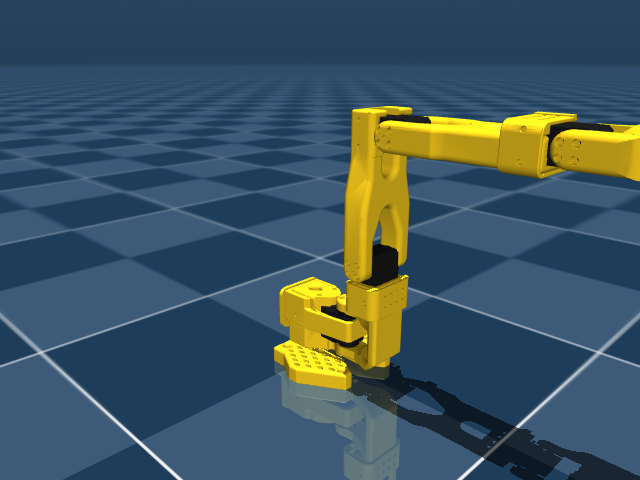
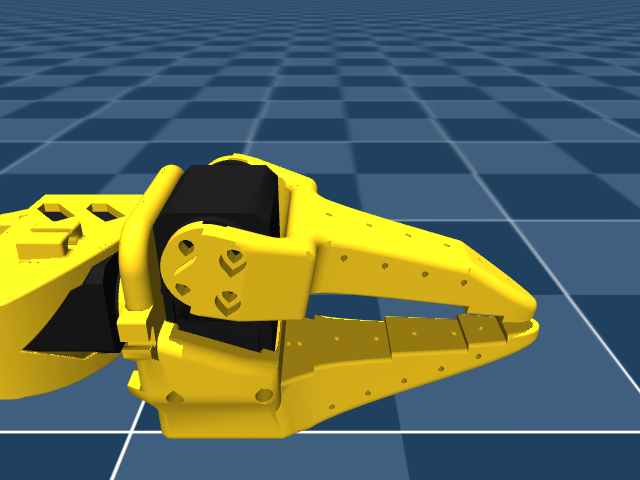
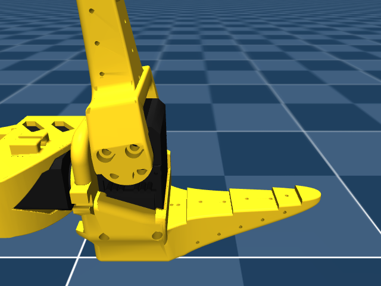

# so101_lift_rl

**中文 TL;DR** — 本仓库是 SO-101 六轴机械臂「强化学习抓取」项目的全栈记录：先离线验证 MuJoCo 仿真模型与夹爪开合方向，再做运动学、抓取策略训练，最后部署到真机。当前 **M1（仿真环境验证）已通过**：MJCF 正常加载并离屏渲染，6 关节 / 6 执行器全部一致，夹爪「低角度=闭合、高角度=张开」，指尖开口 9.1 → 140.4 mm，60/60 步单调递增。完整证据见 [REPORT.md](REPORT.md)。

This repo documents an SO-101 6-DoF arm project for reinforcement-learning grasping. It starts with simulation validation, then moves to kinematics, policy training, and real-robot deployment.

## Roadmap

| Milestone | Scope | Status |
| --- | --- | --- |
| **M1** | Simulation environment validation — load MJCF, enumerate joints/actuators, confirm gripper open/close convention | done — [REPORT.md](REPORT.md) |
| M2 | Kinematics — forward kinematics, Jacobian, inverse kinematics for the grasp pose | planned |
| M3 | Grasping policy training — RL environment + training runs | planned |
| M4 | Simulation final-evaluation — sealed evaluation protocol and metrics | planned |
| M5 | Real-robot deployment — sim-to-real transfer onto the physical arm | planned |

## M1 — Key results



| Gripper at `qmin` (-10°) — closed | Gripper at `qmax` (+100°) — open |
| --- | --- |
|  |  |

| Check | Result |
| --- | --- |
| Joints / actuators | 6 / 6, one-to-one mapping, all `hinge` + position servos |
| Gripper convention | **low q ⇒ CLOSED, high q ⇒ OPEN** (verified over 61 samples) |
| Jaw tip aperture | **9.1 mm (closed) → 140.4 mm (open)** — summary convention, see [REPORT.md](REPORT.md) |
| Monotonicity | **60 / 60** steps increase, 0 decreases |
| MuJoCo version | **3.15.0** |

Raw machine-readable output: [`renders/verify_so101_result.json`](renders/verify_so101_result.json) · console log: [`verify_output.txt`](verify_output.txt).
Additional smoke renders from the Lift environment live in [`so101_lift/renders/`](so101_lift/renders).

## Reproduce M1

```bash
# 1. clone this repo
git clone https://github.com/ccguo32-dev/so101_lift_rl S101 && cd S101

# 2. clone the upstream SO-ARM100 repo and pin the validated revision
git clone https://github.com/TheRobotStudio/SO-ARM100
git -C SO-ARM100 checkout a758567c3978dfeefe282ede0500085a48fe8f78

# 3. create the environment and install pinned dependencies
python -m venv .venv
.venv\Scripts\python.exe -m pip install -r requirements.txt

# 4. run the verification
.venv\Scripts\python.exe verify_so101.py
```

Expected console output should match [`verify_output.txt`](verify_output.txt); the run also writes back [`renders/verify_so101_result.json`](renders/verify_so101_result.json) plus the three PNGs above.

## Project layout

| Path | Role |
| --- | --- |
| `verify_so101.py` | M1 verification script: MJCF introspection, rendering, gripper sweep |
| `verify_output.txt` | Captured console output of the passing run |
| `REPORT.md` | Full M1 report (joint/actuator tables, gripper analysis, caveats) |
| `requirements.txt` | Pinned direct dependencies |
| `renders/` | Showcase images + machine-readable verification result |
| `so101_lift/` | Lift environment: MJCF scene, Gymnasium env, scripted baseline, smoke renders |
| `geom_check/` | Reference STLs from the independent geometry cross-check (not imported at runtime) |
| `SO-ARM100/` | Upstream robot repo, pinned at `a758567c` — ignored by git, cloned via step 2 |
| `.venv/` | Local virtual environment — ignored by git |

## Acknowledgements

Robot model, meshes and MJCF/URDF definitions come from the upstream project
[TheRobotStudio/SO-ARM100](https://github.com/TheRobotStudio/SO-ARM100).
This repository pins it at commit `a758567c3978dfeefe282ede0500085a48fe8f78` for reproducibility.
